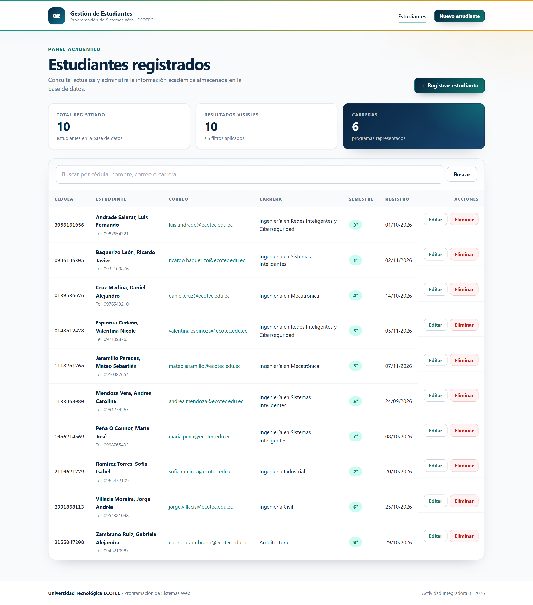

# AI3 · Sistema Web de Gestión de Estudiantes

Módulo web full-stack desarrollado para la **Actividad Integradora 3** de la asignatura **Programación de Sistemas Web** de la **Universidad Tecnológica ECOTEC**.

El sistema permite registrar, consultar, buscar, actualizar y eliminar estudiantes almacenados en una base de datos relacional MySQL/MariaDB, aplicando una arquitectura MVC modular y controles de seguridad para prevenir inyección SQL, XSS y CSRF.



## Características

- Registro de estudiantes con validación en el cliente y en el servidor.
- Listado responsivo con búsqueda por cédula, nombre, correo o carrera.
- Edición y eliminación de registros con confirmación y protección CSRF.
- Validación del dígito verificador de la cédula ecuatoriana.
- Normalización de cédula, correo y teléfono antes de persistir.
- Conexión PDO con manejo de excepciones y mensajes de error genéricos.
- Sentencias preparadas en todas las consultas SQL.
- Saneamiento de todas las salidas HTML con `htmlspecialchars()`.
- Mensajes flash, páginas de error y diseño responsivo.
- Pruebas automatizadas de validación, repositorio y seguridad.

## Stack tecnológico

| Capa | Tecnología |
|------|------------|
| Lenguaje | PHP 8.1+ (probado con PHP 8.3.36) |
| Base de datos | MySQL 8.x / MariaDB 10.4+ (probado con MariaDB 11.4.8) |
| Acceso a datos | PDO con `ATTR_EMULATE_PREPARES = false` |
| Frontend | HTML5, CSS3 y JavaScript vanilla |
| Arquitectura | MVC modular sin framework |
| Pruebas | Runner propio en PHP (`tests/run.php`) |
| Control de versiones | Git + GitHub |

## Arquitectura

```text
AI3_DisenoWeb_CarlosVillegas/
├── app/
│   ├── Config/
│   │   └── conexion.php          # Conexión PDO y configuración
│   ├── Controllers/
│   │   └── EstudianteController.php
│   ├── Core/
│   │   ├── Csrf.php              # Generación y validación de tokens
│   │   ├── Flash.php             # Mensajes de sesión
│   │   ├── HttpException.php     # Errores HTTP tipados
│   │   ├── View.php              # Renderizado de vistas
│   │   └── helpers.php           # Escape HTML y utilidades
│   ├── Models/
│   │   └── Estudiante.php        # Repositorio con sentencias preparadas
│   ├── Validators/
│   │   └── EstudianteValidator.php
│   ├── Views/
│   │   ├── errors/
│   │   ├── estudiantes/
│   │   └── layout/
│   └── bootstrap.php
├── database/
│   └── db_sistema_web.sql        # DDL + datos de ejemplo
├── docs/
│   ├── AI3_Informe_CarlosVillegas.pdf
│   └── evidencias/               # Capturas del sistema en ejecución
├── public/
│   ├── assets/
│   │   ├── css/app.css
│   │   └── js/app.js
│   └── index.php                 # Front controller
├── tests/
│   └── run.php
├── .editorconfig
├── .gitattributes
├── .gitignore
└── README.md
```

### Flujo de una petición

```text
Navegador
   │  GET /index.php?accion=listar
   ▼
public/index.php (front controller)
   │  valida la acción y aplica cabeceras de seguridad
   ▼
EstudianteController
   │  coordina validación, reglas de negocio y respuestas
   ├──► EstudianteValidator (normalización y reglas)
   └──► Estudiante (repositorio)
            │  PDO + sentencias preparadas
            ▼
        MySQL / MariaDB
            │  resultados
            ▼
        Vista HTML + layout
            │  htmlspecialchars() en todas las salidas
            ▼
        Navegador
```

## Requisitos

- PHP 8.1 o superior con las extensiones `pdo_mysql`, `mbstring` y `openssl`.
- MySQL 8.x o MariaDB 10.4+.
- XAMPP, WAMP, Laragon o Docker para el entorno local.
- Git (opcional, para clonar el repositorio).

## Instalación local con XAMPP

1. Clona el repositorio dentro de `htdocs`:

   ```bash
   git clone https://github.com/carlosvillegas2733-rgb/AI3_DisenoWeb_CarlosVillegas.git
   ```

2. Inicia **Apache** y **MySQL** desde el panel de XAMPP.

3. Importa la base de datos:

   - Abre `http://localhost/phpmyadmin`.
   - Selecciona la pestaña **Importar**.
   - Elige el archivo `database/db_sistema_web.sql`.
   - Ejecuta la importación. El script crea la base `db_sistema_web`, la tabla `estudiantes` y diez registros de ejemplo.

4. Verifica la configuración de conexión en `app/Config/conexion.php`. Los valores por defecto funcionan con una instalación estándar de XAMPP:

   ```php
   'host' => '127.0.0.1',
   'port' => '3306',
   'database' => 'db_sistema_web',
   'username' => 'root',
   'password' => '',
   ```

   También puedes definir las variables de entorno `DB_HOST`, `DB_PORT`, `DB_NAME`, `DB_USER` y `DB_PASSWORD` sin modificar el archivo.

5. Abre el sistema en el navegador:

   ```text
   http://localhost/AI3_DisenoWeb_CarlosVillegas/public/
   ```

### Ejecución con el servidor integrado de PHP

Desde la raíz del proyecto:

```bash
php -S localhost:8000 -t public
```

Luego abre `http://localhost:8000`.

## Base de datos

Tabla principal: `estudiantes`.

| Columna | Tipo | Restricción |
|---------|------|-------------|
| `id` | `INT UNSIGNED` | PK, autoincremental |
| `cedula` | `CHAR(10)` | NOT NULL, UNIQUE |
| `nombres` | `VARCHAR(80)` | NOT NULL |
| `apellidos` | `VARCHAR(80)` | NOT NULL |
| `correo` | `VARCHAR(120)` | NOT NULL, UNIQUE |
| `carrera` | `VARCHAR(80)` | NOT NULL |
| `semestre` | `TINYINT UNSIGNED` | NOT NULL, CHECK 1–8 |
| `telefono` | `VARCHAR(16)` | NOT NULL |
| `fecha_creacion` | `TIMESTAMP` | DEFAULT CURRENT_TIMESTAMP |
| `fecha_actualizacion` | `TIMESTAMP` | ON UPDATE CURRENT_TIMESTAMP |

El script `database/db_sistema_web.sql` incluye el DDL completo y datos de ejemplo con cédulas ecuatorianas válidas.

## Pruebas

El proyecto incluye un runner ligero que verifica la normalización, las reglas de validación, el dígito verificador de la cédula, el escape de HTML, la búsqueda y las operaciones CRUD del repositorio dentro de una transacción con rollback.

```bash
php tests/run.php
```

Resultado esperado:

```text
Results: 34 passed, 0 failed, 34 total
All tests passed.
```

## Seguridad implementada

| Riesgo | Medida |
|--------|--------|
| Inyección SQL | PDO con sentencias preparadas y `ATTR_EMULATE_PREPARES = false` |
| XSS | `htmlspecialchars()` con `ENT_QUOTES` y `ENT_SUBSTITUTE` en todas las salidas |
| CSRF | Token aleatorio de 32 bytes por sesión, validado con `hash_equals()` |
| Fuerza bruta de IDs | Validación de identificadores con `filter_var()` y `min_range = 1` |
| Exposición de errores | `try-catch`, logging interno y páginas de error genéricas |
| Secuestro de sesión | Cookie `HttpOnly` y `SameSite=Lax` |
| Clickjacking / MIME sniffing | Cabeceras `X-Frame-Options` y `X-Content-Type-Options` |
| Datos inválidos | Validación en cliente y servidor, normalización y listas blancas |
| Credenciales | Variables de entorno o configuración local fuera de Git |

## Documentación y evidencias

- Informe técnico: [`docs/AI3_Informe_CarlosVillegas.pdf`](docs/AI3_Informe_CarlosVillegas.pdf)
- Capturas del sistema: [`docs/evidencias/`](docs/evidencias/)

## Autor

**Carlos Julio Villegas Bravo**  
Ingeniería en Sistemas Inteligentes  
Facultad de Ingenierías, Arquitectura y Ciencias de la Naturaleza  
Universidad Tecnológica ECOTEC

**Asignatura:** Programación de Sistemas Web  
**Docente:** Gregorio Cruz G., Máster en Diseño y Gestión Web

## Uso académico

Proyecto desarrollado con fines académicos para la Actividad Integradora 3 de la asignatura Programación de Sistemas Web.
